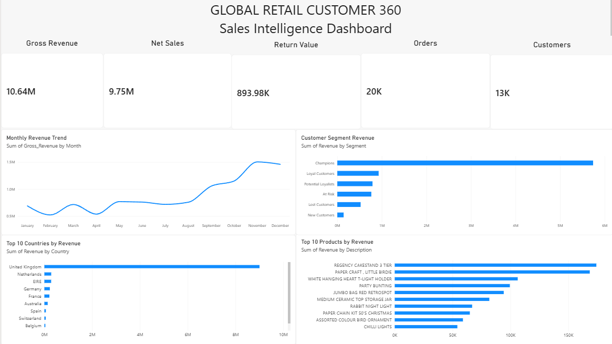

# Global Retail Customer 360 & Sales Intelligence

> **An end-to-end retail analytics and business intelligence project that transforms raw transaction data into validated, customer-level and executive-level business insights using Python, Pandas, MySQL, SQL, and Power BI.**

---

## 📌 Project Overview

**Global Retail Customer 360 & Sales Intelligence** is an end-to-end data analytics project designed to simulate a real-world retail analytics engagement.

The project starts with a large raw transactional dataset containing more than **541,000 transaction records** and takes the data through a complete analytics lifecycle:

```text
Raw Retail Data
      ↓
Data Inspection
      ↓
Data Profiling
      ↓
Data Cleaning
      ↓
Data Validation
      ↓
MySQL Database
      ↓
SQL & Python Analytics
      ↓
Customer & Returns Analysis
      ↓
RFM Customer Segmentation
      ↓
Executive KPIs
      ↓
Power BI Dashboard
      ↓
Business Insights
```

The objective is not simply to create charts.

The objective is to demonstrate how raw business data can be converted into **reliable, decision-ready information** for business stakeholders.

The project answers questions such as:

* How much revenue did the business generate?
* How many orders were placed?
* How many units were sold?
* Which countries generated the most revenue?
* Which products contributed the most revenue?
* How did revenue change month over month?
* Which customers are most valuable?
* What does the customer base look like from an RFM perspective?
* How significant are returns and cancellations?
* Which markets should management prioritize?
* What information should an executive see on a single dashboard?

---

# 🎯 Business Problem

A retail organization typically generates large amounts of transactional data every day.

A raw transaction table may contain information about:

* invoices
* products
* customers
* quantities
* prices
* transaction dates
* countries
* cancellations and returns

However, raw data alone does not directly answer business questions.

For example:

```text
Raw Data:
InvoiceNo | StockCode | Quantity | UnitPrice | CustomerID | Country
```

is not immediately useful to an executive who wants to know:

```text
Revenue this year
Top-performing markets
Monthly sales trend
Top products
Customer value
Return impact
```

Therefore, the project builds a complete analytics pipeline that converts transaction-level data into meaningful business metrics.

---

# 🏢 Business Scenario

This project is designed around a hypothetical international retail business.

The organization wants a centralized view of its sales and customer performance.

Different stakeholders require different levels of information.

### Executive Management

Needs:

* Total revenue
* Total orders
* Customer count
* Product performance
* Revenue trends
* Country performance

### Sales Team

Needs:

* Top products
* High-performing markets
* Monthly sales trends
* Order volume

### Customer Analytics Team

Needs:

* Customer purchasing behavior
* Recency
* Frequency
* Monetary value
* Customer segmentation

### Operations Team

Needs:

* Returns
* Cancellations
* Product-level performance
* Transaction quality

The project combines these requirements into a single analytics solution.

---

# 🚀 Project Objectives

The major objectives are:

1. Understand the structure and quality of raw retail data.
2. Identify duplicates and invalid transactions.
3. Separate sales from returns/cancellations.
4. Clean and standardize transaction records.
5. Validate the cleaned dataset.
6. Load analytical data into MySQL.
7. Perform SQL-based business analysis.
8. Perform customer and return analysis using Python.
9. Build RFM-based customer segmentation.
10. Generate executive-level KPIs.
11. Prepare dashboard-ready datasets.
12. Build an interactive Power BI business dashboard.
13. Translate analytical results into actionable business insights.

---

# 🛠️ Technology Stack

| Technology     | Purpose                                     |
| -------------- | ------------------------------------------- |
| **Python**     | Data processing and analytics               |
| **Pandas**     | Data cleaning, transformation, aggregation  |
| **NumPy**      | Numerical operations                        |
| **MySQL**      | Relational analytical database              |
| **SQL**        | Business analysis and KPI generation        |
| **Power BI**   | Interactive business intelligence dashboard |
| **Matplotlib** | Python-based visualizations                 |
| **Git**        | Version control                             |
| **GitHub**     | Project hosting and documentation           |
| **VS Code**    | Development environment                     |

---

# 🧱 Project Architecture

The project follows a layered analytics architecture.

```text
                 ┌─────────────────────┐
                 │     Raw Dataset     │
                 │    (Excel Data)     │
                 └──────────┬──────────┘
                            │
                            ▼
                 ┌─────────────────────┐
                 │   Data Inspection   │
                 │  Structure & Issues │
                 └──────────┬──────────┘
                            │
                            ▼
                 ┌─────────────────────┐
                 │   Data Profiling    │
                 │ Quality & Statistics│
                 └──────────┬──────────┘
                            │
                            ▼
                 ┌─────────────────────┐
                 │    Data Cleaning    │
                 │ Duplicates / Returns│
                 │ Invalid Transactions│
                 └──────────┬──────────┘
                            │
                            ▼
                 ┌─────────────────────┐
                 │   Data Validation   │
                 │ Quality Verification│
                 └──────────┬──────────┘
                            │
                            ▼
                 ┌─────────────────────┐
                 │       MySQL         │
                 │ Analytical Database │
                 └──────────┬──────────┘
                            │
             ┌──────────────┼──────────────┐
             ▼              ▼              ▼
        SQL Analysis   Python Analysis  Customer
                                      Analytics
             │              │              │
             └──────────────┼──────────────┘
                            ▼
                 ┌─────────────────────┐
                 │ Executive KPIs &   │
                 │ Dashboard Datasets │
                 └──────────┬──────────┘
                            │
                            ▼
                 ┌─────────────────────┐
                 │      Power BI       │
                 │   Global 360        │
                 └─────────────────────┘
```

---

## 📂 Project Structure

```text
Global-Retail-Customer-360_and_Sales-Intelligence/
│
├── dashboard/
│   ├── global_360_dashboard.png
│   └── Global_Retail_Customer_360.pbix
│
├── data/
│   ├── processed/
│   │   ├── customer_360.csv
│   │   ├── customer_rfm.csv
│   │   ├── customer_segments.csv
│   │   ├── dashboard_countries.csv
│   │   ├── dashboard_customer_segments.csv
│   │   ├── dashboard_products.csv
│   │   ├── executive_kpis.csv
│   │   ├── monthly_sales_returns.csv
│   │   ├── returns_transactions.csv
│   │   ├── sales_transactions.csv
│   │   └── top_returned_products.csv
│   │
│   └── raw/
│       └── Online Retail.xlsx
│
├── plots/
│   ├── customer_segment_revenue.png
│   ├── monthly_orders_trend.png
│   ├── monthly_revenue_trend.png
│   └── top_products_revenue.png
│
├── sql/
│   └── 01_sales_kpis.sql
│
├── src/
│   ├── 01_inspect_data.py
│   ├── 02_profile_data.py
│   ├── 03_clean_data.py
│   ├── 04_validate_data.py
│   ├── 05_load_to_mysql.py
│   ├── 06_analytics.py
│   ├── 07_returns_analysis.py
│   ├── 08_rfm_analysis.py
│   ├── 09_executive_kpis.py
│   ├── 10_dashboard_data.py
│   └── 11_visualize.py
│
├── .gitignore
└── README.md
```

> **Note:** `.venv/` is intentionally not shown as part of the shareable project structure because it is a local Python environment and is excluded from GitHub through `.gitignore`.

### Folder Responsibilities

| Folder            | Purpose                                                                                                 |
| ----------------- | ------------------------------------------------------------------------------------------------------- |
| `src/`            | Python data inspection, cleaning, validation, analytics, RFM analysis, KPI generation and visualization |
| `data/raw/`       | Original raw dataset                                                                                    |
| `data/processed/` | Cleaned transaction data and generated analytical datasets                                              |
| `sql/`            | MySQL analytical queries                                                                                |
| `plots/`          | Python-generated analytical visualizations                                                              |
| `dashboard/`      | Power BI dashboard file and dashboard preview image                                                     |
| `.gitignore`      | Prevents sensitive, temporary and unwanted files from being uploaded                                    |
| `README.md`       | Complete project documentation                                                                          |

### 🔄 Python Pipeline

The numbered scripts follow the project workflow:

```text
Online Retail.xlsx
       │
       ▼
01_inspect_data.py
       │
       ▼
02_profile_data.py
       │
       ▼
03_clean_data.py
       │
       ▼
04_validate_data.py
       │
       ▼
05_load_to_mysql.py
       │
       ▼
      MySQL
       │
       ├───────────────┬────────────────┐
       ▼               ▼                ▼
06_analytics.py   07_returns_analysis.py   08_rfm_analysis.py
       │               │                │
       └───────────────┼────────────────┘
                       ▼
               09_executive_kpis.py
                       │
                       ▼
               10_dashboard_data.py
                       │
                       ▼
                  Power BI
                       │
                       ▼
              Global 360 Dashboard
```

### 📊 Generated Outputs

The Python pipeline produces several datasets inside `data/processed/`, including:

* **Customer 360** data
* **RFM customer analysis**
* **Customer segments**
* **Country-level dashboard data**
* **Product-level dashboard data**
* **Executive KPI data**
* **Monthly sales and returns**
* **Sales transactions**
* **Returns transactions**
* **Top returned products**

The `plots/` directory contains visualizations generated using Python for exploratory and analytical reporting.

> The raw dataset and Power BI `.pbix` file are intentionally excluded from GitHub through `.gitignore`.

---

# 📊 Dataset

The project uses a transactional retail dataset containing individual purchase records.

Each row represents a transaction line associated with an invoice and product.

### Main Columns

| Column        | Description                           |
| ------------- | ------------------------------------- |
| `InvoiceNo`   | Unique invoice/transaction identifier |
| `StockCode`   | Product identifier                    |
| `Description` | Product description                   |
| `Quantity`    | Number of units purchased             |
| `InvoiceDate` | Date and time of transaction          |
| `UnitPrice`   | Price per unit                        |
| `CustomerID`  | Customer identifier                   |
| `Country`     | Customer's country                    |

---

# 🔍 Initial Dataset Exploration

The first stage of the project is understanding the raw data before making any changes.

The inspection process identified:

| Metric                 |      Result |
| ---------------------- | ----------: |
| Rows                   | **541,909** |
| Columns                |       **8** |
| Invoices               |  **25,900** |
| Products               |   **4,070** |
| Customers              |   **4,372** |
| Countries              |      **38** |
| Exact duplicate rows   |   **5,268** |
| Negative-quantity rows |  **10,624** |
| Zero-quantity rows     |       **0** |
| Negative-price rows    |       **2** |
| Zero-price rows        |   **2,515** |

The raw dataset covers transactions from:

```text
2010-12-01 08:26
        ↓
2011-12-09 12:50
```

---

# 🔎 Data Inspection

### File

```text
src/01_inspect_data.py
```

The inspection stage is performed before cleaning.

It checks:

* dataset dimensions
* column names
* data types
* missing values
* duplicate records
* quantity distribution
* price distribution
* date range
* customer count
* product count
* country count
* cancellation patterns

This prevents the cleaning process from being based on assumptions.

---

# 📋 Data Profiling

### File

```text
src/02_profile_data.py
```

The profiling stage provides a deeper understanding of the dataset.

It examines:

* numerical distributions
* categorical values
* missing data
* transaction patterns
* customer availability
* product frequency
* country-level distribution
* revenue characteristics

This stage helps identify potential data quality issues before transformation.

---

# 🧹 Data Cleaning

### File

```text
src/03_clean_data.py
```

The cleaning process converts the raw transactional dataset into an analytics-ready dataset.

The following operations were performed:

### 1. Duplicate Removal

The raw dataset contained:

```text
5,268 exact duplicate rows
```

These records were removed to prevent duplicate transactions from inflating business metrics.

---

### 2. Return and Cancellation Identification

Transactions with negative quantities were identified as return/cancellation records.

The cleaned process separated:

```text
Sales Transactions
        +
Returns Transactions
```

This prevents returns from incorrectly appearing as normal sales.

---

### 3. Invalid Price Removal

Transactions containing negative prices were removed.

The raw dataset contained:

```text
2 negative-price records
```

---

### 4. Zero-Price Transaction Handling

Zero-price transactions were also reviewed and excluded from the final sales dataset where appropriate.

---

# 📈 Cleaning Results

After cleaning:

### Sales Dataset

```text
Rows:       524,878
Columns:    9
Revenue:    £10,642,110.80
```

### Returns Dataset

```text
Rows:       10,587
Columns:    9
Return Value: £893,979.73
```

The cleaned sales dataset is stored as:

```text
data/processed/sales_transactions.csv
```

The returns dataset is stored as:

```text
data/processed/returns_transactions.csv
```

---

# ✅ Data Validation

### File

```text
src/04_validate_data.py
```

Cleaning data is not enough.

The resulting dataset must also be validated.

The validation process checks whether the cleaned data satisfies expected business rules.

### Validation Results

| Validation Check            |     Result |
| --------------------------- | ---------: |
| Sales duplicate rows        |      **0** |
| Returns duplicate rows      |      **0** |
| Sales negative quantities   |      **0** |
| Sales zero quantities       |      **0** |
| Sales negative prices       |      **0** |
| Sales zero prices           |      **0** |
| Returns negative quantities | **10,587** |

The negative quantities in the returns dataset are intentional because they represent returned/cancelled quantities.

This validation step ensures that the dataset used for business analysis is consistent with the project's rules.

---

# 🗄️ MySQL Database

### File

```text
src/05_load_to_mysql.py
```

After cleaning and validation, the processed sales data is loaded into MySQL.

MySQL provides a structured relational environment for performing repeatable SQL-based analysis.

The database layer allows the project to move from:

```text
CSV-based processing
```

to:

```text
Structured analytical querying
```

---

# 🧮 SQL Analytics

After loading the data into MySQL, SQL is used to answer business questions.

The analysis includes:

* revenue
* units sold
* orders
* products
* customers
* monthly performance
* country performance
* product performance

This demonstrates how SQL can be used to convert transaction-level records into business metrics.

---

# 📌 Executive KPIs

The current analytical dataset produces the following major KPIs:

| KPI                  |             Value |
| -------------------- | ----------------: |
| Total Revenue        | **£8,887,208.89** |
| Total Units Sold     |     **5,152,002** |
| Total Orders         |        **18,532** |
| Total Products       |         **3,665** |
| Identified Customers |         **4,338** |

These metrics form the foundation of the executive dashboard.

---

# 📅 Monthly Revenue Analysis

The monthly revenue analysis shows the evolution of business performance throughout the available period.

| Month    |       Revenue |
| -------- | ------------: |
| Dec 2010 |   £821,452.73 |
| Jan 2011 |   £689,811.61 |
| Feb 2011 |   £522,545.56 |
| Mar 2011 |   £716,215.26 |
| Apr 2011 |   £536,968.49 |
| May 2011 |   £769,296.61 |
| Jun 2011 |   £760,547.01 |
| Jul 2011 |   £718,076.12 |
| Aug 2011 |   £757,841.38 |
| Sep 2011 | £1,056,435.19 |
| Oct 2011 | £1,151,263.73 |
| Nov 2011 | £1,503,866.78 |
| Dec 2011 |   £637,790.33 |

### Key Observation

November 2011 represents the strongest month in the available dataset with revenue of approximately:

```text
£1.50 million
```

The business also shows strong growth from September through November.

---

# 🛒 Monthly Order Analysis

The project also calculates monthly order volume.

The highest monthly order count occurs in:

```text
November 2011
```

with:

```text
2,769 orders
```

This provides a useful comparison between revenue growth and order volume.

---

# 🌍 Country-Level Analysis

Country-level performance is one of the major components of the Customer 360 analysis.

### Top Revenue Markets

| Country        |           Revenue |
| -------------- | ----------------: |
| United Kingdom | **£9,001,744.09** |
| Netherlands    |   **£285,446.34** |
| EIRE           |   **£283,140.52** |
| Germany        |   **£228,678.40** |
| France         |   **£209,625.37** |

The United Kingdom is the dominant market in the dataset.

This type of analysis allows management to identify:

* core markets
* international opportunities
* regional concentration
* potential expansion markets

---

# 📦 Product Performance

The project also identifies products generating the highest revenue.

Examples include:

| Product                   |         Revenue |
| ------------------------- | --------------: |
| DOTCOM POSTAGE            | **£206,248.77** |
| Regency Cakestand         | **£174,156.54** |
| Paper Craft Little Birdie | **£168,469.60** |

Product-level analysis can help identify:

* high-value products
* revenue concentration
* products requiring inventory attention
* opportunities for cross-selling
* potential product optimization strategies

---

# 🔄 Returns Analysis

### File

```text
src/07_returns_analysis.py
```

Returns are analyzed separately from normal sales.

This is important because simply subtracting negative transactions from sales without understanding their nature can hide useful operational information.

The project identifies:

```text
10,587 return/cancellation transactions
```

with a return value of approximately:

```text
£893,979.73
```

The analysis can be used to investigate:

* return volume
* return value
* cancellation patterns
* products associated with returns
* potential operational issues

---

# 👥 Customer Analytics

The project goes beyond transaction-level sales analysis by examining customers.

Customer-level analysis helps answer:

* Who are the most valuable customers?
* Which customers purchase frequently?
* Which customers have not purchased recently?
* Which customers generate the most revenue?

This transforms the project from basic sales reporting into a **Customer 360-style analytics solution**.

---

# 🧠 RFM Customer Segmentation

### File

```text
src/08_rfm_analysis.py
```

RFM analysis is used to understand customer purchasing behavior.

RFM stands for:

### Recency

How recently did the customer make a purchase?

```text
Recent purchase → Higher recency score
```

### Frequency

How frequently does the customer purchase?

```text
More purchases → Higher frequency score
```

### Monetary

How much revenue does the customer generate?

```text
Higher spending → Higher monetary score
```

Together:

```text
Customer
   ↓
Recency
Frequency
Monetary
   ↓
RFM Score
   ↓
Customer Segment
```

This enables customer groups to be interpreted from a business perspective.

Potential segments include:

* Champions
* Loyal Customers
* Potential Loyalists
* At-Risk Customers
* Recent Customers
* Low-Value Customers

The exact segmentation depends on the scoring logic implemented in the project.

---

# 📊 Executive KPI Generation

### File

```text
src/09_executive_kpis.py
```

This module consolidates important business metrics for executive reporting.

The purpose is to bridge the gap between:

```text
Detailed transaction data
```

and:

```text
Executive decision-making
```

Instead of forcing management to inspect thousands of rows, the module produces concise business indicators.

---

# 🖥️ Dashboard Data Preparation

### File

```text
src/10_dashboard_data.py
```

This stage prepares analytical data required by the Power BI dashboard.

The dashboard focuses on:

* revenue
* orders
* units
* customers
* monthly trends
* country performance
* product performance

The separation of dashboard preparation from visualization makes the workflow easier to maintain.

---

# 📉 Python Visualization

### File

```text
src/11_visualize.py
```

Python-based visualization is used to create supporting analytical plots.

These visualizations help verify analytical results before presenting them through Power BI.

Generated plots are stored in:

```text
plots/
```

---

# 📊 Power BI — Global 360 Dashboard

The final business intelligence layer is an interactive Power BI dashboard named:

# **Global 360**

The dashboard converts the analytical results into an executive-friendly visual interface.

It provides a high-level overview of business performance while allowing users to compare major dimensions such as:

* revenue
* orders
* products
* customers
* countries
* monthly performance

---

## Dashboard Components

The dashboard contains key executive visuals including:

### KPI Cards

Provides a quick overview of major metrics such as:

* Gross Revenue
* Orders
* Units Sold
* Customers
* Products

---

### Monthly Revenue Trend

A time-series visualization shows how revenue changes across the available months.

This makes major growth periods and weaker periods easier to identify.

---

### Revenue by Country

A ranked country-level visualization highlights the highest-revenue markets.

The dashboard includes a **Top 10 Countries by Revenue** view to focus attention on the most commercially significant markets.

---

### Product Performance

The dashboard also provides visibility into high-performing products and their contribution to revenue.

---

## 📸 Dashboard Preview



---

# 🔄 Complete Execution Flow

The recommended execution sequence is:

```text
1. 01_inspect_data.py
        ↓
2. 02_profile_data.py
        ↓
3. 03_clean_data.py
        ↓
4. 04_validate_data.py
        ↓
5. 05_load_to_mysql.py
        ↓
6. 06_analytics.py
        ↓
7. 07_returns_analysis.py
        ↓
8. 08_rfm_analysis.py
        ↓
9. 09_executive_kpis.py
        ↓
10. 10_dashboard_data.py
        ↓
11. 11_visualize.py
        ↓
12. Power BI — Global 360
```

The analytical modules after MySQL can also be treated as parallel analysis branches:

```text
                     MySQL
                       │
        ┌──────────────┼───────────────┐
        ↓              ↓               ↓
   Analytics       Returns            RFM
        │           Analysis        Analysis
        │              │               │
        └──────────────┼───────────────┘
                       ↓
                Executive KPIs
                       ↓
                Dashboard Data
                       ↓
                   Power BI
```

---

# ▶️ How to Run the Project

## 1. Clone the Repository

```bash
git clone <your-github-repository-url>
```

Move into the project:

```bash
cd Global-Retail-Customer-360_and_Sales-Intelligence
```

---

# 2. Create a Virtual Environment

Windows:

```powershell
python -m venv .venv
```

Activate it:

```powershell
.venv\Scripts\Activate.ps1
```

---

# 3. Install Dependencies

Install the required Python packages:

```bash
pip install pandas numpy matplotlib mysql-connector-python
```

If a `requirements.txt` file is included in the repository, use:

```bash
pip install -r requirements.txt
```

---

# 4. Download and Add the Raw Dataset

This project uses the **Online Retail** dataset from the **UCI Machine Learning Repository**.

The dataset contains **541,909 transaction records** from a UK-based online retail business, covering transactions from **December 2010 to December 2011**.

### 📥 Download

Download the original dataset from the official UCI repository:

**[UCI Online Retail Dataset](https://archive.ics.uci.edu/dataset/352/online%2Bretail)**

Download:

```text
Online Retail.xlsx
```

### 📂 Add to the Project

After downloading, place the file inside:

```text
data/raw/Online Retail.xlsx
```

Your structure should look like:

```text
data/
├── raw/
│   └── Online Retail.xlsx
│
└── processed/
    ├── sales_transactions.csv
    └── returns_transactions.csv
```

The raw dataset is **not included in this GitHub repository** because it is excluded through `.gitignore`. Users can download the original dataset from UCI using the link above.

After placing the file in the correct location, start the pipeline with:

```bash
python src/01_inspect_data.py
```

> **Note:** Use the original **Online Retail** dataset (UCI Dataset ID 352), not the separate **Online Retail II** dataset.


---

# 5. Inspect the Data

Run:

```bash
python src/01_inspect_data.py
```

This provides an initial understanding of the dataset.

---

# 6. Profile the Dataset

Run:

```bash
python src/02_profile_data.py
```

Review the generated profiling information.

---

# 7. Clean the Data

Run:

```bash
python src/03_clean_data.py
```

This generates:

```text
data/processed/sales_transactions.csv
data/processed/returns_transactions.csv
```

---

# 8. Validate the Cleaned Data

Run:

```bash
python src/04_validate_data.py
```

The validation stage confirms that the cleaned dataset satisfies the project's data-quality rules.

---

# 9. Configure MySQL

Create a MySQL database for the project.

Example:

```sql
CREATE DATABASE global_retail;
```

Configure the database connection in:

```text
src/05_load_to_mysql.py
```

Use your local MySQL credentials.

**Do not commit passwords or credentials to GitHub.**

Use environment variables if credentials are required.

---

# 10. Load Data into MySQL

Run:

```bash
python src/05_load_to_mysql.py
```

The processed sales data will be loaded into MySQL.

---

# 11. Run Analytics

Run the analytical scripts as required:

```bash
python src/06_analytics.py
python src/07_returns_analysis.py
python src/08_rfm_analysis.py
python src/09_executive_kpis.py
python src/10_dashboard_data.py
python src/11_visualize.py
```

---

# 12. Open Power BI

Open Power BI Desktop and connect the required analytical data.

The final dashboard is named:

```text
Global 360
```

The `.pbix` file is intentionally not stored in GitHub.

---

# 🧪 Data Quality Checks

The project includes explicit data-quality validation instead of assuming the raw dataset is correct.

The pipeline checks for:

* duplicate records
* invalid quantities
* invalid prices
* return transactions
* zero-value transactions
* missing customer identifiers
* transaction consistency

This makes the analytics more reliable and closer to a real-world data workflow.

---

# 💡 Key Business Insights

Based on the completed analysis:

### 1. United Kingdom is the dominant market

The UK generates approximately:

```text
£9.00 million
```

in revenue within the analyzed country-level results.

This indicates a strong concentration of business activity in the UK.

---

### 2. November is the strongest revenue month

November 2011 generated approximately:

```text
£1.50 million
```

making it the strongest month in the available monthly analysis.

This suggests a significant seasonal or promotional demand period worth investigating.

---

### 3. Revenue is concentrated among leading products

Several products contribute disproportionately to overall revenue.

For example:

```text
DOTCOM POSTAGE
Regency Cakestand
Paper Craft Little Birdie
```

appear among the highest-revenue products.

This highlights the importance of understanding product-level revenue concentration.

---

### 4. Returns represent a meaningful operational signal

The analysis identified:

```text
10,587
```

return/cancellation transactions with a return value of approximately:

```text
£893,979.73
```

This means returns should be analyzed separately rather than treated simply as ordinary sales records.

---

### 5. Customer-level analysis provides additional business value

Revenue alone does not tell the complete story.

Two customers can generate the same revenue but have very different purchasing behaviors.

RFM analysis makes it possible to distinguish customers based on:

```text
Recency
Frequency
Monetary Value
```

which can support targeted customer retention and marketing strategies.

---

# 🎯 Business Recommendations

Based on the analytical findings, a retail organization could consider:

### Strengthen Core Markets

The UK represents the dominant revenue market.

Management should protect this core market while monitoring opportunities in international markets.

---

### Investigate High-Growth Periods

The sharp increase in revenue from September through November suggests that management should investigate:

* seasonal demand
* promotional campaigns
* product availability
* customer acquisition
* holiday purchasing behavior

---

### Optimize High-Performing Products

Products generating significant revenue should receive attention regarding:

* inventory availability
* pricing
* promotions
* cross-selling
* product bundling

---

### Use Customer Segmentation

RFM segmentation can support different strategies for different customer groups.

For example:

```text
Champions
    ↓
Retention & loyalty

Loyal Customers
    ↓
Cross-selling

At-Risk Customers
    ↓
Re-engagement campaigns

Low-Value Customers
    ↓
Targeted promotional strategies
```

---

### Monitor Returns

High-return products or customer groups should be investigated for possible:

* quality issues
* product description problems
* fulfillment problems
* customer expectation gaps

---

# 🔐 Data & Privacy

The raw dataset is excluded from this repository through `.gitignore`.

The Power BI `.pbix` file is also excluded.

The repository does not contain:

* passwords
* API keys
* database credentials
* `.env` files
* local virtual environments

This keeps the repository safe to share publicly.

---

# 📌 Why This Project Matters

This project demonstrates a complete analytics workflow rather than focusing on a single tool.

It combines:

```text
Python
   +
Pandas
   +
SQL
   +
MySQL
   +
Customer Analytics
   +
Business Intelligence
   +
Power BI
```

The important part is the connection between these technologies.

Python is used for data preparation and analytical processing.

MySQL provides a structured environment for querying business data.

SQL converts transactional records into business metrics.

RFM analysis adds customer-level intelligence.

Power BI transforms those metrics into an executive-facing dashboard.

Together, they form a complete:

```text
Data → Information → Insight → Decision
```

pipeline.

---

# 🧠 Skills Demonstrated

## Data Analytics

* Exploratory Data Analysis
* Data Cleaning
* Data Profiling
* Data Validation
* Feature/metric creation
* Aggregation
* Business KPI analysis

## Python

* Pandas
* NumPy
* Matplotlib
* Data transformation
* Statistical summaries
* Analytical scripting

## SQL

* Aggregations
* GROUP BY
* Filtering
* Date-based analysis
* Revenue calculations
* Customer analysis
* Product analysis
* Business KPI generation

## MySQL

* Database creation
* Table management
* Data loading
* Analytical querying
* Relational data analysis

## Customer Analytics

* RFM analysis
* Customer segmentation
* Recency analysis
* Frequency analysis
* Monetary analysis

## Business Intelligence

* Power BI
* KPI cards
* Trend analysis
* Country analysis
* Product analysis
* Top-N analysis
* Executive dashboard design

## Engineering Practices

* Modular Python scripts
* Data validation
* Reproducible workflow
* Version control
* Git/GitHub
* Environment isolation
* Secret management

---

# 📈 Project Outcome

The project successfully transforms a raw dataset containing:

```text
541,909 transaction records
```

into a validated analytics workflow containing:

```text
524,878 cleaned sales transactions
10,587 return transactions
18,532 analyzed orders
5,152,002 units sold
4,338 identified customers
3,665 analyzed products
```

and an executive-facing Power BI dashboard.

The result is a complete retail analytics solution capable of supporting:

* sales performance monitoring
* customer analysis
* product analysis
* market analysis
* return analysis
* executive reporting

---

<!-- # 🚀 Future Enhancements

Possible future enhancements include:

* automated ETL pipelines
* scheduled data refresh
* cloud data storage
* Azure Data Factory
* Azure Data Lake
* Databricks
* Apache Spark / PySpark
* Snowflake
* incremental data processing
* automated data-quality monitoring
* advanced customer lifetime value analysis
* predictive sales forecasting

These technologies are intentionally outside the scope of the current project.

A separate cloud-scale data engineering project can be used to demonstrate those capabilities.

--- -->

# 👨‍💻 Author

**Shouvanik Santra**

Electronics & Communication Engineering
Data Analytics | Data Science | Machine Learning | AI

---

<!-- # ⭐ Project Highlights

```text
✔ 541K+ raw transaction records
✔ 524K+ cleaned sales transactions
✔ 10K+ return/cancellation transactions
✔ 18K+ analyzed orders
✔ 5K+ units analyzed
✔ 4K+ customers analyzed
✔ 3K+ products analyzed
✔ 38 countries
✔ Python + Pandas
✔ MySQL + SQL
✔ RFM Customer Segmentation
✔ Power BI Executive Dashboard
✔ End-to-End Analytics Workflow
```

--- -->

# 📜 License

This project is intended for educational, portfolio, and demonstration purposes.
